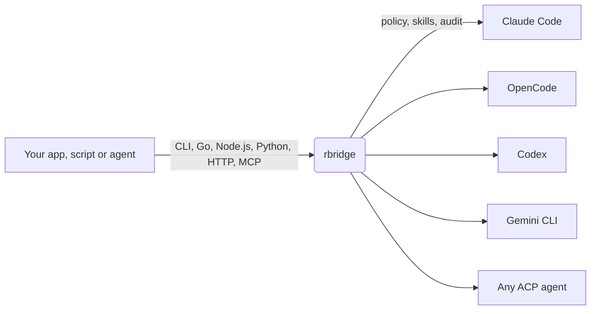

<p align="center">
  <picture>
    <source media="(prefers-color-scheme: dark)" srcset="assets/logo-dark.png">
    
  </picture>
</p>

<p align="center">
  <b>One local interface to the agent runtimes already on your machine.</b><br>
  Free, open source, local first. Your runtimes, your sign-ins, your rules.
</p>

<p align="center">
  <a href="https://github.com/runtime-bridge/rbridge"></a>
  <a href="https://github.com/runtime-bridge/rbridge-sdk-ts"></a>
  <a href="https://github.com/runtime-bridge/rbridge-sdk-python"></a>
  <a href="https://github.com/runtime-bridge/rbridge/blob/main/LICENSE"></a>
</p>

---

Developers already pay for and sign in to agent runtimes such as Claude Code, OpenCode, Codex and Gemini CLI. rbridge lets any program on the same machine hand work to those runtimes through one interface, with the same events, approvals and Agent Skills whichever runtime does the work.

rbridge does not run its own agent loop and never touches provider credentials. It starts the runtime you installed, speaks a documented protocol to it (the Agent Client Protocol, or a runtime's own headless mode), and stands between it and the software that gives it tasks.



### What you get

- **Detection** of every installed runtime and account, with version, integration and sign-in mode.
- **Tasks and sessions** with streamed events, cancel, resume and structured output.
- **Agent Skills** kept in a library with digests and trust states, delivered to each runtime the way it expects.
- **Policy profiles** that decide what a runtime may do, and ask you only when they should. Each session says plainly what is enforced and what is not.
- **An audit log** with one record per session, without prompts or outputs.
- **A daemon** that serves several applications over a local socket or loopback HTTP, each seeing only its own sessions.

### Repositories

| Repository | What it is |
|---|---|
| [rbridge](https://github.com/runtime-bridge/rbridge) | The CLI, daemon, MCP server and Go library |
| [rbridge-sdk-ts](https://github.com/runtime-bridge/rbridge-sdk-ts) | Node.js client, no dependencies |
| [rbridge-sdk-python](https://github.com/runtime-bridge/rbridge-sdk-python) | Python client, standard library only |

### Try it

Install rbridge and see which runtimes it finds:

```sh
curl -fsSL https://raw.githubusercontent.com/runtime-bridge/rbridge/main/scripts/install.sh | sh
rbridge doctor
rbridge run --workspace ~/src/app "Summarise what this project does"
```

Or with Go: `go install github.com/runtime-bridge/rbridge/cmd/rbridge@latest`.

The SDKs talk to the rbridge daemon, so start it once with `rbridge daemon start`.

**Node.js** (20 or later)

```sh
npm install github:runtime-bridge/rbridge-sdk-ts
```

```js
import { connect } from "@rbridge/sdk";

const rb = await connect({ client: "my-app" });
const result = await rb.run(
  { workspace: "/home/me/src/app", prompt: "Summarise what this project does" },
  { onEvent: (e) => e.type === "message.delta" && process.stdout.write(e.data.text) },
);
console.log(result.output);
rb.close();
```

**Python** (3.10 or later)

```sh
pip install git+https://github.com/runtime-bridge/rbridge-sdk-python
```

```python
import rbridge

with rbridge.connect(client="my-app") as rb:
    result = rb.run(
        {"workspace": "/home/me/src/app", "prompt": "Summarise what this project does"},
        on_event=lambda e: e["type"] == "message.delta" and print(e["data"]["text"], end=""),
    )
    print(result["output"])
```

Permission requests go to an `approver` you pass in; without one they are denied. Each SDK's README covers sessions, approvals, skills, modes and the HTTP transport.

### Principles

Local by default: nothing leaves your machine except what your own runtimes send to their providers. No credentials handled, ever. No runtime bundled, installed or modified. Honest about limits: rbridge is not a sandbox, and it tells you which controls it enforces.

<sub>Security problems: please use private vulnerability reporting on the affected repository. Everything else: issues and discussions are open.</sub>
